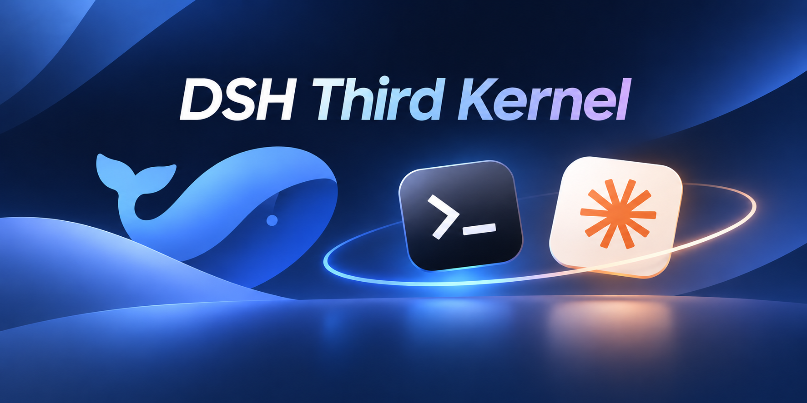

<div align="center"><a name="readme-top"></a>



# DSH Third Kernel

[![npm version][npm-version-src]][npm-version-href]
[![npm downloads][npm-downloads-src]][npm-downloads-href]
[![bundle][bundle-src]][bundle-href]
[![JSDocs][jsdocs-src]][jsdocs-href]
[![License][license-src]][license-href]

为 DeepSeek (DSH) 接入本机 **Codex** 与 **Claude Code** 内核。会话区一键新建第三方内核会话，模型与推理强度沿用官方 composer，权限沿用官方会话权限；切回 DSH 即恢复官方会话。

</div>

## 📦 安装

使用命令行安装：

```sh
dsh plugin add dsh-third-kernel
```

- 样式走 [dsh-taiwind](https://github.com/hairyf/dsh-taiwind) 共享编译。
- 装完在 **设置 → 插件** 里确认已启用。

### DSH 版本要求

本插件只适配 **DSH 0.2.2-rc.1 及以上的 0.2.2 线**，并在 `package.json` 的 `peerDependencies` 里固定该版本线（`^0.2.2-rc.1`，cordis `^4.1.0`）：不满足时 DSH 会在安装阶段直接拒绝加载，而不是让插件在半坏状态下运行。

- **不再支持旧版 DSH**。0.2.2 把 `sessionProjections.register()` 改为返回 `ProjectionHandle`、移除了 registry 级 `stateOf`，把工具呈现从 `tools.presentAs()` 换成 `tools.setExecutor()`，并把 `permissions` 投影压缩成预设名——本插件已按新接口重写，旧版本没有对应实现。
- 手动绕过 peer 检查装上时，后端探测会把该核心标成「协议不兼容」，切换器里的内核保持禁用。

## 前置条件

| 内核 | 本机需要 | 探测方式 |
| --- | --- | --- |
| Codex | 已登录的 `codex` CLI，支持 `app-server` | `codex app-server --help` 返回 0 |
| Claude Code | 已登录的 `claude` CLI，支持 `stream-json` | `claude --help` 输出含 `stream-json` |

>  两个 CLI 都得先在终端自行登录（`codex login` / `claude auth login`），插件不代管凭证；登录状态会显示在切换器里。

## 特性


- 🧭 **内核选择器**：会话页顶部新增内核切换（Codex / Claude），选中即创建已绑定内核的新会话。
- 🏷️ **会话标识**：会话头部与侧栏行显示该会话绑定的内核图标与名称；hero 标题区保持官方原样（鲸鱼标记 + 探索未至之境 / 预览版）。
- 🎛️ **模型选择**：输入框模型菜单改为内核自带模型目录，Codex 与 Claude 的推理档位统一展示；改动从下一轮对话起生效。
- 🔐 **权限沿用官方**：权限模式仍由官方会话权限决定，自动映射到各内核的审批与沙箱策略，不新增开关。
- 🧩 **只做增量**：AppFrame、品牌行、侧栏、会话列表、输入链、工作区均保持官方实现，插件仅通过公开插槽与投影接入。
- 🎨 **两套配色**：Codex 冷灰、Claude 暖纸，均以 `tk-` 前缀隔离，不影响官方主题。

## 🚀 快速开始

### 新建一个 Codex / Claude 会话

1. 在会话区点内核 chip（Hero 里的选择器），选 **Codex** 或 **Claude**。
2. 插件调宿主 `POST /api/tauri/bridge/sessions`，宿主起子进程、完成握手、建立会话。
3. 不可用时，选项保持禁用并显示原因（未安装 / 未登录 / 协议不兼容 / 核心不支持桥接）

## 🛠️ 开发与贡献

```sh
pnpm run lint --fix
pnpm run typecheck
pnpm run test    # 先 build 再 vitest
pnpm run build
```

### 适配的 DSH API（0.2.2-rc.1）

| 能力 | 旧接入（≤ 0.2.1） | 现接入（0.2.2-rc.1） |
| --- | --- | --- |
| 会话投影 | `sessionProjections.register()` 同步返回 disposer，registry 级 `stateOf(session, key)` | 注册 await 得到 `ProjectionHandle`，插件自己保留句柄且只用 `handle.stateOf(session)` |
| 工具呈现 | `agent.ctx.tools.presentAs('native')` | `agent.ctx.tools.setExecutor()` + 官方 `ToolExecutionPipeline` 原生回放查找（每 scope 只能有一个执行器） |
| 会话权限 | `permissions` 投影带 `sandbox` / `approval` | `ctx.sandboxPolicy.overrideOf()` + `ctx.approval.overrideOf()`（投影现在只保留预设名） |
| 回合边界 | `turnBoundary` 投影 | `ctx.agents.turnBoundaryOf(session)`（投影降级为宿主内部单元） |
| 插件记录 | 可选导出，缺失即静默降级 | `appendPluginRecord` / `pluginRecordOf` 为硬依赖，缺失即 `BRIDGE_CORE_UNAVAILABLE` |

### 验证状态

- `pnpm run build`（含 publint）在本机通过；类型检查与全仓 lint 正在运行。
- 全量 Vitest 共 69 项：66 项通过、3 项失败。新增 8 项原生工具回放回归使用真实官方工具服务与管线，覆盖 Bash/Grep 缺失于步骤快照、原生错误、跨步骤与跨回合清理、调用和结果一致性，以及普通工具的快照准入。
- 真实 Claude CLI 2.1.296 的单回合接入测试通过。真实 Codex CLI 0.162.0 的单回合、文本去重和回合选项测试失败；回合选项测试捕获到上游 `403 账户余额不足`，另两项未收到预期文本。这是本机已有的账号限制，未修改断言或跳过测试。

### 子仓库

- [source/dsh-tui](https://github.com/ccch1mneyyy/dsh-TUI) — 协议参考。
- [source/dsh-tauri](https://github.com/dsh-tauri/deepseek-harness-desktop)（v0.24.5）— 桌面壳参考。

```sh
git submodule update --init --recursive
```

## 📜️ 许可证

[MIT](<LICENSE.md>) © [hairyf](https://github.com/hairyf)

<!-- Badges -->

[npm-version-src]: https://img.shields.io/npm/v/dsh-third-kernel?style=flat&colorA=080f12&colorB=1fa669
[npm-version-href]: https://npmjs.com/package/dsh-third-kernel
[npm-downloads-src]: https://img.shields.io/npm/dm/dsh-third-kernel?style=flat&colorA=080f12&colorB=1fa669
[npm-downloads-href]: https://npmjs.com/package/dsh-third-kernel
[bundle-src]: https://img.shields.io/bundlephobia/minzip/dsh-third-kernel?style=flat&colorA=080f12&colorB=1fa669&label=minzip
[bundle-href]: https://bundlephobia.com/result?p=dsh-third-kernel
[license-src]: https://img.shields.io/github/license/hairyf/dsh-third-kernel.svg?style=flat&colorA=080f12&colorB=1fa669
[license-href]: https://github.com/hairyf/dsh-third-kernel/blob/main/LICENSE
[jsdocs-src]: https://img.shields.io/badge/jsdocs-reference-080f12?style=flat&colorA=080f12&colorB=1fa669
[jsdocs-href]: https://www.jsdocs.io/package/dsh-third-kernel
